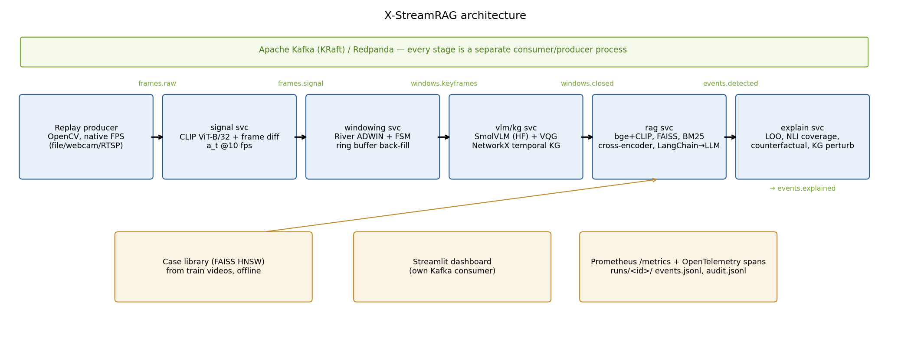

# X-StreamRAG — Explainable Time-Aware Streaming RAG for real-time video event detection

IOE413 Streaming Data Analytics mini project (Topic 7, Group 15).

A replayed (or live) traffic camera stream flows through **Kafka** between five separate
service processes. Each process cuts the stream into **adaptive temporal windows** (River
ADWIN plus a CALM/ALERT/EVENT state machine with pre-event back-fill), describes keyframes
with a small **VLM** and a question bank, keeps a **NetworkX temporal KG**, retrieves similar
past windows (**FAISS** + BM25 + KG, cross-encoder rerank), and asks an **LLM** (through a
**LangChain** chain) whether an incident is happening, citing evidence IDs. An
**explainability** service then measures which evidence drove each decision.

| Base paper | Reproduced / used | Our enhancement |
|---|---|---|
| StreamingRAG (Sankaradas et al., 2024) | **B1 baseline**: 2 fps keyframes, VLM + question bank + Visual Query Generator, NetworkX KG, frame-level kNN, LLM | – |
| TD-RAG (Xu et al., 2025) | window text embeddings, kNN top-k, recency constraint (**B2**: fixed W s windows, step W/6) | windows are **adaptive** (change-point driven) and applied to video |
| CityCopilot-X (Gudipati et al., 2026) | retrieval/rerank attribution, coverage, counterfactual removal, drift, Prometheus/OTel audit | applied to multimodal streaming evidence (frames, VQA, KG triples, past windows) |

**Enhancement (B3):** adaptive ADWIN windows with a fair VLM budget and 3 s ring-buffer
back-fill, plus sequence context, hybrid dense + BM25 + KG retrieval with cross-encoder
rerank, plus an off-hot-path explainability engine (E1–E6).



## Data flow (every arrow is a Kafka topic)

```
replay_producer ─frames.raw─▶ signal_svc ─frames.signal─▶ windowing_svc ─windows.keyframes─▶ vlm_kg_svc
   ─windows.closed─▶ rag_svc ─events.detected─▶ explain_svc ─events.explained─▶ (dashboard consumer)
```

| Service | File | Does |
|---|---|---|
| producer | `scripts/replay_producer.py` | video/webcam/RTSP → JPEG (640 px) at native FPS (`--speed 2/4` stress, `0` fast replay), key = source_id |
| signal | `services/signal_svc.py` | ~10 fps: a_t = 0.6·(1−cos CLIP) + 0.4·pixel diff (CLIP ViT-B/32) |
| windowing | `services/windowing_svc.py` | adaptive (B3) / fixed (B2) / per-frame (B1) windows, ring buffer, VLM budget |
| vlm/kg | `services/vlm_kg_svc.py` | SmolVLM caption + ≤5 VQA (VQG rules), KG triples, window summary, sqlite VLM cache |
| rag | `services/rag_svc.py` | bge-small + CLIP encode, LangChain retriever (FAISS HNSW case library + session memory + BM25), rerank, LangChain prompt → LLM → JSON, label-probability confidence, event debounce, E6 drift |
| explain | `services/explain_svc.py` | E1 leave-one-out, E2 temporal heat, E3 NLI coverage, E4 counterfactual top-k vs random-k, E5 KG perturbation → `audit.jsonl` |
| dashboard | `dashboard/app.py` | Streamlit with its own Kafka consumer, plus Prometheus metrics strip |

Every service exports Prometheus metrics (`xs_frames_ingested_total`, `xs_fps`,
`xs_stage_latency_seconds{stage}`, `xs_vlm_calls_total`, `xs_e2e_alert_latency_seconds`,
`xs_window_state`, …) and OpenTelemetry spans (`extract`, `kg_update`, `encode`, `retrieve`,
`rerank`, `generate`, `explain`) to the console.

## Tools and versions

| Tool | Version | Role |
|---|---|---|
| Apache Kafka (KRaft) | 3.9.1 (WSL2, `scripts/infra_wsl.sh`) — or Redpanda v24.2.7 via `docker-compose.yml` | stream backbone |
| confluent-kafka | 2.11.1 | Kafka client |
| River | 0.22.0 | ADWIN change detection |
| OpenCV (headless) | 4.11.0.86 | ingest, JPEG, frame diff |
| PyTorch (CPU) | 2.8.0 | model runtime |
| HF transformers | 4.56.2 | SmolVLM-256M-Instruct (VLM), CLIP ViT-B/32, Qwen2.5-1.5B-Instruct (LLM) |
| sentence-transformers | 5.1.1 | bge-small-en-v1.5, ms-marco-MiniLM-L-6-v2 reranker, nli-deberta-v3-small |
| FAISS (cpu) | 1.12.0 | HNSW case library |
| rank-bm25 | 0.2.2 | BM25 |
| NetworkX | 3.6.1 | temporal KG |
| LangChain core | 0.3.76 | retriever wrapper + prompt → LLM → parser chain |
| Streamlit | 1.50.0 | dashboard |
| pyvis | 0.3.2 | KG subgraph view |
| Prometheus | 2.54.1 | metrics (scrapes every 1 s) |
| prometheus-client / OpenTelemetry SDK | 0.23.1 / 1.37.0 | metrics / spans |
| scikit-learn, SciPy, pandas, matplotlib | 1.7.2, 1.16.2, 2.3.3, 3.10.6 | evaluation + figures |
| Python / Java | 3.13.5 / OpenJDK 17 (WSL) | |

Every run also stores its exact library versions and git commit in `runs/<id>/manifest.json`.

Hardware used for all reported numbers: i5-1340P, 16 GB RAM, Intel Iris Xe (**no CUDA**),
Windows 11 + WSL2. All models run on the CPU.

## Setup

### Windows (what we used)
```powershell
python -m venv .venv
.venv\Scripts\python -m pip install torch==2.8.0 torchvision==0.23.0 --index-url https://download.pytorch.org/whl/cpu
.venv\Scripts\python -m pip install -r requirements.txt
copy .env.example .env          # only needed for the optional Gemini backends
# Kafka + Prometheus without Docker (needs WSL2 Ubuntu with Java 17 and curl):
wsl -d Ubuntu -- bash scripts/infra_wsl.sh up      # downloads Kafka 3.9.1 + Prometheus once
.venv\Scripts\python scripts\smoke_test.py         # M0: produce + consume one message
.venv\Scripts\python -m pytest -q                  # 17 tests (windowing, matching, metrics)
```
If Docker Desktop is installed, `docker compose up -d --wait` (Redpanda + Prometheus) replaces the WSL script.

### Linux / WSL
```bash
make venv && make infra && make smoke && make test
```

### Datasets
- `data/videos/` – 16 dev clips (bundled, see `data/README.md`).
- UCF-Crime videos: `bash scripts/download_datasets.sh`, then put them under `data/ucf_crime/videos/<Class>/`.
  The test set is then picked up automatically (RoadAccidents 23 + Explosion 21 + 20 Normal, seed 42, first 3 min).
- **Dev-set event times:** fill `event_start_s` / `event_end_s` in `data/annotations_devset.csv`
  (several segments: separate with `;`). `python scripts/annotate_helper.py` writes thumbnail
  contact sheets (one every 0.5 s) to `report/annotate/` to make this quick.

## Running

```bash
# offline case library (UCF train if present, else the dev clips with leave-one-video-out)
python scripts/build_case_library.py --source devset

# one configuration end to end through Kafka + evaluation
python scripts/run_experiment.py --config configs/baselines/b3.yaml

# main comparison B3, B2, B1 + McNemar + figures
bash scripts/run_main.sh

# live demo: services + dashboard + one accident clip at native speed
bash scripts/run_all.sh configs/demo.yaml
streamlit run dashboard/app.py
python scripts/replay_producer.py data/videos/accident/cctv_compilation_acc_ved.mp4 --speed 1
# webcam / IP camera instead:   python scripts/replay_producer.py 0     |   ... rtsp://<ip>/stream
bash scripts/stop_services.sh
```

`run_experiment.py` gives each run its own Kafka namespace (topics `<run_id>.frames.raw`, …).
It replays the clips (fast replay, `--speed 0`, by default; `--speed 1` for latency runs), waits
until every clip's end-of-stream marker reaches `events.explained`, and then writes:

```
runs/<run_id>/  manifest.json config.yaml signal/*.csv windows.jsonl vlm_calls.jsonl
                verdicts.jsonl events.jsonl audit.jsonl keyframes/ kg/ logs/
results/<run_id>/metrics.json   results/summary.csv   results/results_table.md
report/figures/*.png
```

### Configurations
| Config | What changes |
|---|---|
| `configs/baselines/b1.yaml` | StreamingRAG: 2 fps keyframes, one keyframe per unit, frame-level kNN (text), no explainability |
| `configs/baselines/b2.yaml` (`b2_w2`, `b2_w8`) | fixed W = 4 (2, 8) s windows, step W/6, uniform keyframes at the B3 budget, dense window kNN + session recency |
| `configs/baselines/b3.yaml` | adaptive windows + back-fill, sequence context, hybrid retrieval + rerank, explainability |
| `configs/ablations/*.yaml`, `configs/sweeps/*.yaml` | B3 ablations and the RQ3 VLM-budget sweep (not run for the submission, see below) |

Every threshold, model and budget lives in `configs/default.yaml`. Models sit behind
`VLMBackend` / `LLMBackend` / `Embedder` interfaces (`xstream/backends.py`):
`vlm.backend: smolvlm | gemini | blip2`, `llm.backend: hf | gemini | ollama`.

## Results

All numbers come from `results/` (see `results/results_table.md`, regenerated by
`scripts/make_figures.py`). See **RESULTS.md** for the tables of the submitted runs and how
to read them.

## Known limitations (read before the viva)
- **No UCF-Crime videos on the dev machine.** The runs use the 16 dev clips as a fallback test
  set, and the case library comes from the same 16 clips with leave-one-video-out retrieval.
  The numbers are a small-sample sanity check, not the planned UCF-Crime evaluation.
- **Dev-set event times are not annotated yet**, so event-level recall, short-event recall,
  detection delay, alert latency, frame AUC and the pointing game are `null` until
  `data/annotations_devset.csv` is filled. Only video-level metrics are reported.
- CPU only: SmolVLM-256M (≈4.5 s/keyframe) and Qwen2.5-1.5B (≈6 s/window) are far below
  real time. Experiments therefore run in fast-replay mode, and windowing → LLM feedback (EVENT
  state) is disabled there to keep runs deterministic; it is enabled in `configs/demo.yaml`.
- Qwen2.5-0.5B was tried first and rejected: it gave P(collision) > 0.99 to a calm-scene
  window. The prompt also states that most windows are normal (`xstream/generate.py`).
- E4 counterfactuals are scoring-only by default (Δconfidence, flip rate, faithfulness gap);
  `explain.regenerate: true` adds Δcoverage and semantic drift at a large CPU cost.
- Not run (deadline mode): **B2** (fixed windows; config `configs/baselines/b2.yaml` is ready), so RQ3
  (adaptive vs fixed at a matched budget) is not answered: B1 vs B3 shows the combined effect
  of windows + adaptivity + hybrid retrieval, not adaptivity alone. Also not implemented: B0,
  human rating, TAD, Exp-0 AirQualityUCI, Grafana.
  The ablation and budget-sweep configs exist but were not run.
- StreamingRAG's scheduler details are unpublished, so B1 is a re-implementation following
  the paper's description, not an exact reproduction. The BLIP-2, Gemini and Ollama backends
  are implemented but untested here (no CUDA, no API key, no Ollama).
