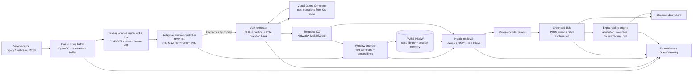

# X-StreamRAG — Implementation Plan

**Explainable Time-Aware Streaming RAG for Real-Time Multimodal Event Detection**
Streaming Data Analytics, Mini Project (Assigned Topic 7, Group 15)

---

## 0. TL;DR

We build a pipeline that watches a live (or replayed) traffic video stream and does five things. It cuts the stream into **adaptive temporal windows** that are short when the scene changes and long when it is calm. It describes the important frames with a **small VLM** and stores the facts in a **temporal knowledge graph**. It retrieves **similar past windows** and graph facts. An **LLM** then decides whether an event (collision, rollover, fight…) is happening and explains why, citing the evidence. Finally, an **explainability engine** measures which frames and evidence drove the decision and removes that evidence to test whether the explanation holds up.

| Base paper | What we take | What we add |
|---|---|---|
| **StreamingRAG** (Sankaradas et al., 2024) is the baseline we reproduce. | Lightweight VLM, question bank with a Visual Query Generator, priority frame scheduling, a NetworkX KG, and the ITS accident use case. | Temporal-window retrieval, adaptive windows with a pre-event buffer, and explanations. |
| **TD-RAG** (Xu et al., 2025) supplies the temporal retrieval method. | Windows embedded as text, cosine kNN over historical windows (top-k = 5), and a recency constraint. | Windows are adaptive (change-point driven) instead of a fixed 6 h, applied to video instead of sensor rows. |
| **CityCopilot-X** (Gudipati et al., 2026) supplies the explainability method. | Retrieval and rerank attribution, token-level coverage, counterfactual evidence removal (Δcoverage, Δconfidence), drift monitoring, and Prometheus/OTel auditing. | Applied to *multimodal streaming* evidence (frames, VQA answers, KG triples, historical windows) instead of civic text. |

**What is already in this folder:**
- `data/` holds 16 real traffic clips for development, the UCF-Crime frame-level temporal labels for all 290 test videos, and AirQualityUCI (TD-RAG's dataset).
- `scripts/download_papers.py` downloads all 22 arXiv references.
- `scripts/download_datasets.sh` downloads the full TAD and UCF-Crime data.

---

## 1. Research questions → how each one is answered

| RQ | Hypothesis | Experiment | Primary metric |
|---|---|---|---|
| **Main** | A time-aware, explainable RAG improves event-detection accuracy and reliability while staying real-time. | Full system vs. B0/B1 baselines on UCF-Crime and TAD. | F1, P95 latency, FPS |
| **RQ1** | Window-level retrieval beats frame-level retrieval for contextual understanding. | B1 (frame retrieval) vs. B2 (fixed windows) vs. B3 (adaptive windows), same VLM and LLM. | Event F1, temporal-sequence accuracy, Retrieval P@5 |
| **RQ2** | Attribution can identify *which* frames, entities and evidence caused the prediction. | Leave-one-out and ContextCite attribution, then check where the top evidence lies in time against the ground-truth event interval. | Temporal pointing-game accuracy, coverage |
| **RQ3** | Adaptive windows save compute without missing short events. | B2 (fixed sampling) vs. B3 (adaptive with pre-event buffer) at matched VLM budget. | Short-event recall (≤ 3 s), frame-processing ratio, VLM calls/min |
| **RQ4** | Counterfactual removal of evidence measures explanation reliability. | Remove the top-k attributed evidence, compare against removing random-k evidence. | Δconfidence, Δcoverage, flip rate, faithfulness gap |

**Why UCF-Crime suits RQ3:** we computed the durations of its 23 annotated RoadAccidents test segments. The median is **3.0 s**, with a range of 1.0–6.3 s, and **12 of 23 last ≤ 3 s**. That gives a natural short-event subset.

---

## 2. Datasets

### 2.1 What we use and why

| ID | Dataset | Role | Labels | Status |
|---|---|---|---|---|
| **D0** | Dev set: 16 clips (12 accident, 4 normal) from public GitHub repos | Debugging, prompt tuning, demo | Category per clip; **the team must annotate start/end** in `data/annotations_devset.csv` (≈30 min of work) | ✅ downloaded (70 MB) |
| **D1** | **UCF-Crime** (Sultani et al., CVPR 2018): real surveillance video, 13 anomaly classes | **Main test set.** Its frame-level temporal labels enable the short-event, latency and pointing-game metrics. | Test: frame-level start/end (✅ downloaded). Train: video-level labels (✅ list downloaded). | Labels ✅. Videos must be downloaded on your machine (≈ 100 GB total; we need only a few parts). |
| **D2** | **TAD** (Xu et al., IEEE Access 2025): 344 highway surveillance videos | Cross-dataset test for generalisation and video-level accuracy. Closest match to StreamingRAG's ITS IP-camera setting. | Video-level accident / no-accident labels plus bounding boxes | Google Drive link in the script |
| **D3** | **AirQualityUCI** (TD-RAG's dataset): 9,357 hourly rows | Optional Experiment 0. Reproduces TD-RAG's fixed-vs-adaptive window retrieval on a cheap numeric stream with no GPU. | Derived risk label (see §7.1) | ✅ downloaded |
| **D4** | Live webcam / IP camera (phone running *IP Webcam* app) | Live demo only, not used for metrics | none | at demo time |

### 2.2 Test-set composition (D1)

| Class (UCF-Crime test) | # videos | Maps to our event type |
|---|---|---|
| RoadAccidents | 23 | `vehicle_collision` / `vehicle_pedestrian_collision` |
| Explosion | 21 | `fire_explosion` |
| Fighting | 5 | `people_commotion` |
| Assault | 3 | `people_commotion` |
| Normal (random sample, seed 42, first 3 min each) | 40 | `none` |
| **Total** | **92 videos** | |

- **Case library** (TD-RAG's "historical windows"): windows extracted from UCF-Crime *train* videos (127 RoadAccidents, 29 Explosion, 45 Fighting, 47 Assault, and a 150-video Normal sample). Each window carries its video-level label. There is **never** any overlap with test videos.
- **Stage annotation for RQ1:** for 20 RoadAccidents test videos, two members annotate stage order, e.g. `approach → impact → person_down → vehicle_leaves`. This supports the temporal-sequence-accuracy metric (StreamingRAG judged hit-and-run detection by exactly this sequence).

### 2.3 Stream replay (making files behave like a live stream)

```
VideoReplaySource(path, speed=1.0)
  └─ thread: reads frame i, sleeps until wall_clock_start + i/fps,
             pushes Frame(id, video_ts, ingest_ts=time.monotonic(), bgr) into a bounded queue
             if queue full → drop oldest (real cameras do not wait for you)
```
- Every frame carries `video_ts` (for matching against ground truth) and `ingest_ts` (for latency).
- The same interface wraps `cv2.VideoCapture(0)` for a webcam and an `rtsp://` / `http://` URL for an IP camera.
- A `--speed` flag allows 2× and 4× replay for stress tests (the throughput metric).

---

## 3. System architecture



**Concurrency model.** Each stage is a worker thread (or process for GPU stages) connected by bounded `queue.Queue`s. This mirrors DataX's microservice graph in StreamingRAG, minus the cluster. The VLM is the bottleneck, so the **scheduler, not the queue, decides which frames reach it**. Counterfactual explainability runs **off the hot path** in a separate worker, so it never adds to alert latency. Its own latency is reported separately.

---

## 4. Modules in detail

### M1. Ingest & buffering (OpenCV)
- `Frame` dataclass: `id, video_ts, ingest_ts, bgr (downscaled to 640 px wide), source_id`.
- **Ring buffer** of the last 3 s of full-rate frames (`collections.deque(maxlen=3*fps)`). When an alert fires we look *backwards* into this buffer, which is the key trick for short events (RQ3).
- Pre-processing: resize, BGR→RGB, optional letterbox for the VLM.

### M2. Cheap change signal (runs on every 3rd frame ≈ 10 fps)
For frame *t*:

```
a_t = 0.6 · (1 − cos(clip_t, clip_{t−1}))          # semantic change, CLIP ViT-B/32 image embedding
    + 0.4 · mean(|gray_t − gray_{t−1}|) / 255       # pixel motion
```
- CLIP ViT-B/32 runs at well over 100 img/s batched on a T4, so it is cheap. The same embedding is reused later for visual retrieval.
- *Optional:* YOLOv8n object counts (car/person/motorcycle) plus ByteTrack speed drops, as an extra "sudden stop" feature.

### M3. Adaptive temporal window controller (core contribution for RQ3)

**State machine**

| State | Enter when | VLM keyframes / s | Window length |
|---|---|---|---|
| CALM | default | 0.5 | grows up to 16 s, closes on change point |
| ALERT | `a_t > μ + 3σ` (rolling 30 s stats), **or** ADWIN change point, **or** a VQA hazard answer = yes | 2 | 2–4 s |
| EVENT | the LLM returns `event_type ≠ none` with confidence ≥ 0.5 | 4 (≈ StreamingRAG's priority mode) | 1–2 s, overlapping by 50 % |
| → CALM | 10 s with no hazard and `a_t` back below μ + 1σ | | |

**Window boundaries:** `river.drift.ADWIN(delta=0.002)` is fed the stream `a_t`. A detected change closes the current window and opens a new one. Hard limits are min 1 s and max 16 s.

**Pre-event back-fill:** on CALM→ALERT, the frames from the last 3 s of the ring buffer with the highest `a_t` (top 2) are *also* sent to the VLM. A 1-second collision that happened between two CALM samples is therefore still seen.

**Fixed-window ablation (TD-RAG style, B2):** windows of `W` s with step `W/6`, mirroring TD-RAG's 6 h window and 1 h step. We sweep `W ∈ {2, 4, 8}` s with uniform keyframe sampling at the same *average* VLM budget as B3, so the comparison is fair.

```python
class AdaptiveWindower:
    def __init__(self, adwin_delta=0.002, k_sigma=3.0, min_len=1.0, max_len=16.0):
        self.adwin = river.drift.ADWIN(delta=adwin_delta)
        self.stats = RollingMeanStd(seconds=30)
        self.state, self.win = "CALM", WindowBuilder()

    def step(self, frame, a_t, hazard_flag=False):
        self.adwin.update(a_t); z = self.stats.z(a_t); self.stats.add(a_t)
        change = self.adwin.drift_detected
        if self.state == "CALM" and (z > self.k_sigma or change or hazard_flag):
            self.state = "ALERT"; self.backfill_from_ring_buffer(top=2)
        closed = None
        if (change and self.win.length >= self.min_len) or self.win.length >= self.max_len_for(self.state):
            closed = self.win.close(); self.win = WindowBuilder(start=frame.video_ts)
        if self.should_sample(frame, self.state): self.win.add_keyframe(frame, priority=a_t)
        return closed     # → M4 extraction is triggered per keyframe, M6 encoding per closed window
```

### M4. VLM extraction (StreamingRAG's lightweight VLM + question bank)
- **Default model:** `Salesforce/blip2-opt-2.7b` in 8-bit (fits a T4 or a 12 GB card) for captions and VQA.
  - **CPU / low-VRAM fallback:** `HuggingFaceTB/SmolVLM-256M-Instruct`.
  - **Stronger option if you have ≥ 16 GB:** `Qwen2.5-VL-3B-Instruct`.
- **Per keyframe:** one caption, plus ≤ 5 VQA questions. StreamingRAG used up to 5 per prompt for real-time latency.
- **Base question bank** (traffic):
  1. How many vehicles are visible?
  2. Is any vehicle damaged or overturned?
  3. Is a person lying on the road?
  4. Are two vehicles touching each other?
  5. Is there smoke or fire?
  6. Are people running or gathering?
  7. Is any vehicle moving away quickly?
- **Visual Query Generator:** `Q_{t+k} = VQG(S_t, KB)`. A rule table plus KG state chooses the next questions. Examples:
  - "two vehicles touching = yes" → ask "is a person lying near the vehicles?" and "is a vehicle leaving?"
  - "smoke = yes" → ask "is there fire?"
  
  This reproduces StreamingRAG's VQG. A small LLM version is an optional extension.
- **Knowledge base (KB):** a hand-written YAML of actor and object types, allowed relations and event templates. StreamingRAG's KB was also manually built. Example template: `hit_and_run = [collision, person_down, vehicle_leaves]`.

### M5. Temporal knowledge graph (NetworkX)
- `nx.MultiDiGraph`.
  - **Nodes:** `Window(id, t0, t1, state)`, `Keyframe(id, ts)`, `Entity(id, type ∈ {vehicle, person, motorcycle, fire, …})`, `Event(id, type, t0, t1)`.
  - **Edges:** `Entity —[rel {near, collides_with, lying_on, leaves, on_fire}, t0, t1, conf, src_keyframes]→ Entity`, `Window —NEXT→ Window`, `Keyframe —IN→ Window`, `Entity —OBSERVED_IN→ Keyframe`, `Event —SUPPORTED_BY→ edge/keyframe`.
- **Triples from VQA:** answers are mapped to triples by rules. Example: "two vehicles touching = yes" → `(vehicle_a, collides_with, vehicle_b, t)`. We do not attempt object identity across frames beyond YOLO and ByteTrack IDs if they are enabled.
- **Reset policy:** like StreamingRAG, prune nodes older than 120 s unless attached to an open Event. Closed Events are archived to JSON.
- Every triple gets a stable ID (`T17`) so it can be **cited and removed** in the explainability step.

### M6. Window encoder & index (TD-RAG's temporal windows)
- **Text summary per closed window** (this is what TD-RAG's "semantic window representation" becomes for video):
  ```
  [W42 | 12.0–14.5 s | ALERT] t=12.3 caption: "a white car hits a motorcycle at an intersection";
  t=12.3 Q: two vehicles touching? A: yes; t=13.1 Q: person lying on road? A: yes;
  triples: (car_1 collides_with moto_1 @12.3) (person_1 lying_on road @13.1)
  ```
- **Embeddings:**
  - Text: `BAAI/bge-small-en-v1.5` (384-d) via sentence-transformers. TD-RAG used OpenAI `text-embedding-3-large`; we use a free local model and can test it as an ablation.
  - Visual: mean CLIP embedding of the window's keyframes (512-d).
  - Fused score: `s = 0.7·cos_text + 0.3·cos_clip`.
- **Indexes:**
  - FAISS `IndexHNSWFlat` with inner product on L2-normalised vectors (cosine), the same family TD-RAG used.
    - (a) **Case library:** built offline from training windows, each with its label.
    - (b) **Session memory:** windows of the current stream with a **recency constraint** of the last 10 min, mirroring TD-RAG's 90-day constraint.
  - Metadata lives in a parallel `list[dict]` and `sqlite` table.
- **Sequence context (RQ1):** the query is the *current window plus the previous 2 windows*, so the LLM sees a sequence and not a frame.

### M7. Retrieval + rerank (CityCopilot-X retrieval & reranking attribution)
- **Candidates** (each candidate is an *evidence unit* with an ID):
  - Dense top-10 from the case library (`H*` units: "similar past window, label = collision, sim 0.81").
  - Top-5 from session memory (`S*`).
  - BM25 (`rank_bm25`) top-5 over window texts.
  - Current-window captions and VQA answers (`F*`).
  - KG 1-hop subgraph of the current window's entities (`T*`).
- **Rerank:** `cross-encoder/ms-marco-MiniLM-L-6-v2`. The query is the standing query plus the current window summary. Keep the top 8.
- **Log every stage's score per unit** (dense, BM25, rerank, final rank) so the dashboard can show *why* each unit made the cut. This is the "retrieval and reranking attribution" feature from CityCopilot-X.

### M8. Grounded generation (LLM)
- **Local LLM (default):** `Qwen2.5-7B-Instruct` (4-bit) via Ollama or transformers.
- **Lighter local LLM:** `Qwen2.5-1.5B-Instruct`.
- **API option:** any hosted LLM (e.g. Gemini). Use a cache keyed by prompt hash.
- **Standing queries** (from StreamingRAG):
  - "Alert on a collision between vehicles and/or people."
  - "Notify when pedestrians in distress are spotted."
  - We add: "Report fire or explosions."
- **Prompt** (abridged):
  ```
  You are a traffic-incident analyst. Use ONLY the evidence units below. Cite every claim with [ID].
  Evidence:
  [F3] t=12.3 caption: a white car hits a motorcycle ...
  [T17] (car_1 collides_with moto_1) 12.3–12.8 s
  [H2] past window (label=vehicle_collision, sim=0.81): "two cars collide at a junction ..."
  ...
  Return JSON: {"event_type": one of [none, vehicle_collision, vehicle_pedestrian_collision,
   hit_and_run, rollover, fire_explosion, people_commotion],
   "start_s": float, "end_s": float, "sequence": [stage,...],
   "explanation": "2-4 sentences with [IDs]", "cited_ids": [...]}
  ```
- **Confidence (needed for Δconfidence):**
  - With a local model: score each label string's log-probability given the prompt, then softmax over the 7 labels. This gives `P(label)` and is deterministic.
  - With an API model: self-consistency, i.e. the fraction of 5 samples at temperature 0.7 that agree.
  - Never use the model's self-reported confidence.
- **Event logic:**
  - An event is *opened* when `P(event≠none) ≥ 0.5` in 2 of the last 3 windows (debounce).
  - It is *closed* after 2 consecutive `none` windows.
  - Alert latency = `alert_wallclock − ingest_ts(first GT event frame)`.

### M9. Explainability engine (CityCopilot-X → multimodal)

| Feature | Method | Output |
|---|---|---|
| **E1 Evidence attribution** | Leave-one-out over the ≤ 8 evidence units (9 LLM scoring calls). For offline analysis, ContextCite: 32 random 50 % ablation masks + Lasso surrogate. | weight per unit |
| **E2 Temporal attribution** | Project unit weights onto the timeline (`F`/`T` units have timestamps; `H` units are "context"). | heat strip over time; top frame |
| **E3 Grounded coverage** | Split the explanation into claims. For each claim, compute NLI entailment (`cross-encoder/nli-deberta-v3-small`) against the units it cites. Supported if p(entail) ≥ 0.5. | claim coverage, token-level coverage, unsupported % |
| **E4 Counterfactual removal (RQ4)** | Re-generate with the top-k attributed units removed (k = 1, 2, 3) and with random-k removed (5 seeds). Also remove the whole GT event time slice vs. a same-length non-event slice. | Δconfidence, Δcoverage, label-flip rate, semantic drift = 1 − cos(expl, expl′) |
| **E5 KG perturbation** | KGRAG-Ex style: remove one node, one edge or one triple of the cited subgraph and see whether the output changes. | most influential entity/relation |
| **E6 Drift monitor** | Rolling centroid of window embeddings (last 60 s vs. previous 10 min). Cosine distance > threshold → "scene drift" badge (camera moved, night, rain). | drift score time series |

Evidence units, attributions and counterfactual results are written to an **audit log** (`runs/<run_id>/audit.jsonl`), one record per event. This is the "Metrics & Audit Bus" idea from CityCopilot-X.

### M10. Streamlit dashboard
Layout:
- **Left:** live frame with the state badge (CALM/ALERT/EVENT), plus a timeline strip of windows coloured by state and the GT overlay in replay mode.
- **Centre:** event cards. Each shows type, time, confidence and an explanation with clickable `[ID]`s.
- **Right:** evidence panel for the selected event:
  - keyframes with timestamps
  - attribution bars (E1)
  - temporal heat strip (E2)
  - coverage % with unsupported claims in red (E3)
  - counterfactual table (E4)
  - KG subgraph rendered with `pyvis` (E5)
- **Bottom:** live metrics (FPS, P50/P95 latency, VLM calls/min, GPU memory, frame-processing ratio) read from the Prometheus endpoint.
- **Architecture:** the pipeline runs as a separate process and writes to `sqlite` and `audit.jsonl`. Streamlit polls every 1 s, because Streamlit reruns the script on every interaction.

### M11. Monitoring (Prometheus + OpenTelemetry)
- **`prometheus_client` metrics:**
  - `xs_frames_ingested_total`, `xs_frames_to_vlm_total`, `xs_vlm_calls_total{kind=caption|vqa}`
  - `xs_stage_latency_seconds{stage}` (histogram), `xs_e2e_alert_latency_seconds` (histogram)
  - `xs_fps` (gauge), `xs_gpu_mem_bytes` (gauge, from `torch.cuda.memory_allocated`), `xs_window_state` (gauge)
- **OpenTelemetry:** one trace per window, with spans for `extract`, `kg_update`, `encode`, `retrieve`, `rerank`, `generate` and `explain`. Use the console/OTLP exporter; Jaeger in Docker is optional.
- Prometheus runs in Docker with a scrape interval of 1 s. A Grafana board is optional; the Streamlit metrics strip is enough for the report.

---

## 5. Baselines and ablations

| ID | System | Sampling | Retrieval | KG | Explain | Answers |
|---|---|---|---|---|---|---|
| **B0** | Caption-every-frame baseline (StreamingRAG's baseline) | fixed 1 fps, captions only | none (LLM summarises the last 10 captions) | ✗ | ✗ | Main |
| **B1** | StreamingRAG re-implementation | fixed 2 fps + VQG question bank | frame-level kNN (single keyframe text) | ✓ | ✗ | Main, RQ1 |
| **B2** | + fixed temporal windows (TD-RAG) | fixed, W ∈ {2,4,8} s, step W/6 | window-level kNN, top-5, recency | ✓ | ✓ | RQ1, RQ3 |
| **B3** | **X-StreamRAG (full)** | adaptive (ADWIN + FSM + back-fill) | window + sequence + hybrid + rerank | ✓ | ✓ | all |

**Ablations on B3:**
- −KG
- −reranker
- −case library (session memory only)
- −back-fill
- −CLIP visual score
- top-k ∈ {3, 5, 10}
- text embedder: bge-small vs. MiniLM
- VLM: BLIP-2 vs. SmolVLM

**Fair budget rule:** when comparing B2 and B3 for RQ3, both get the same total number of VLM calls per minute of video. B3 must spend them better, not just spend more.

---

## 6. Metrics (exact definitions)

**Event detection** (computed per video and per event)
- *Video-level* accuracy, precision, recall, F1: positive if any event is raised. This is comparable to TD-RAG's table and StreamingRAG's "x of 8 detected".
- *Event-level* match: a predicted event matches a GT segment when temporal IoU ≥ 0.1 **or** the prediction starts inside the GT segment ± 2 s. This handles very short GT segments.
- *Type accuracy*: the matched event's type equals the mapped GT class.
- *Frame-level ROC-AUC*: `P(event≠none)` per frame against UCF labels. This is the standard UCF-Crime metric and lets us compare loosely with the anomaly-detection literature.

**Temporal**
- *Short-event detection rate:* recall on GT segments ≤ 3 s (12 of 23 RoadAccidents segments).
- *Detection delay:* `alert_time − GT_start` (seconds of video time).
- *Temporal-sequence accuracy:* for the 20 stage-annotated videos, exact-order match and normalised Kendall-τ between predicted `sequence` and GT stages.
- *Retrieval P@K / R@K* (K = 5): a retrieved case-library window is relevant if its label equals the GT class of the query window. A session window is relevant if it overlaps the same GT event.

**Streaming performance**
- *End-to-end alert latency* P50/P95: from ingest of the first GT event frame to the alert.
- *Per-stage latency:* from OTel spans.
- *Sustained throughput:* the maximum replay speed at which the queue backlog stays < 1 s. Report it as effective FPS; StreamingRAG reported ≈ 8 FPS.
- *GPU memory:* peak (`torch.cuda.max_memory_allocated`) per model and total. StreamingRAG's table reports VLM 8 GB and total 10 GB.
- *CPU utilisation:* `psutil`, mean and peak.

**Efficiency**
- *Frame-processing ratio* = frames sent to VLM ÷ frames ingested.
- *VLM calls per minute.*
- *ms per ingested frame.*

**Explainability**
- *Coverage* (claim-level and token-level) and *unsupported proportion*. CityCopilot-X reported 61 % → 79 % token coverage vs. baseline RAG.
- *Temporal pointing game:* % of events whose top-1 attributed timestamped unit lies inside the GT segment ± 1 s.
- *Counterfactual:* mean Δconfidence and Δcoverage for top-k removal vs. random-k removal. **Faithfulness gap** = Δconf(top-k) − Δconf(random-k), which should be > 0. Also report label-flip rate and semantic drift.
- *Human rating* on 30 events: 4 raters score correctness, groundedness and usefulness on a 1–5 scale. Report Fleiss' κ.

**Statistics:**
- Bootstrap 95 % CIs over videos (1,000 resamples).
- McNemar test for paired detection outcomes (B3 vs. B1/B2).
- Wilcoxon signed-rank test for latency.
- Seeds fixed and every config saved per run.

---

## 7. Experiments, in order

### 7.1 Exp-0 (optional, no GPU): TD-RAG reproduction on AirQualityUCI
- **Preprocessing:** parse `;` separators and `,` decimals. Treat `-200` as NaN and forward-fill ≤ 3 h.
- **Months:** January, April, July and October, as in the TD-RAG setup.
- **Risk label:** the TD-RAG paper's exact definition is not in our proposal, so **check it in the PDF**. Until then, use this placeholder: label = 1 if the mean `CO(GT)` over the next 6 h exceeds the 75th percentile of the training months.
- **Windows:** 6 h windows with a 1 h step.
- **Text template:**
  - Example: "CO rose from 1.2 to 3.4 mg/m³, NOx peaked 210 ppb at 18:00, T 13 °C …"
  - Embed the text, retrieve top-5 among windows ≤ 90 days old, and let the LLM predict.
- **Compare:** single-row RAG vs. fixed 6 h window RAG vs. **adaptive windows** (ADWIN on CO).
- **Why:** a cheap, quick result that validates M3 and M6 before the video pipeline is ready.

### 7.2 Exp-1: Main comparison (B0–B3) on D1 test set (92 videos)
### 7.3 Exp-2: RQ3 budget sweep — VLM calls/min ∈ {15, 30, 60, 120}; plot short-event recall vs. budget for B2 and B3
### 7.4 Exp-3: RQ2/RQ4 explainability on all detected events of B3 (+ human rating on 30)
### 7.5 Exp-4: Cross-dataset generalisation on TAD (video-level only, case library still from UCF-train)
### 7.6 Exp-5: Live demo on webcam/IP camera (qualitative, latency only)

---

## 8. Compute plan

| Component | Model | VRAM (approx.) | Notes |
|---|---|---|---|
| Change signal | CLIP ViT-B/32 | ~0.6 GB | batch 16 |
| VLM | BLIP-2 OPT-2.7B, 8-bit | ~4–5 GB | fp16 ≈ 8 GB |
| Text embed / rerank / NLI | bge-small, MiniLM cross-encoder, DeBERTa-v3-small NLI | ~1 GB | CPU is fine too |
| LLM | Qwen2.5-7B-Instruct, 4-bit | ~5–6 GB | or 1.5B (~2 GB), or an API |
| **Total** | | **~11–13 GB** | fits a 16 GB T4 (Colab or Kaggle); on a 12 GB card use the 1.5B LLM or an API |

- **Measure, don't assume.** Log the real numbers from M11; the table above is only a planning estimate.
- **Run offline evaluation in "replay as fast as possible" mode** with timestamps preserved. Real-time pacing is only needed for the latency and throughput experiments.
- **Cache VLM outputs per (video, frame_id, question)** in sqlite. Ablations that change only retrieval or LLM settings then don't re-run the VLM. This is the single biggest time saver.

---

## 9. Repository layout

```
xstream-rag/
├── plan.md                      ← this file
├── configs/
│   ├── default.yaml             # all thresholds, models, k, budgets
│   └── baselines/{b0,b1,b2,b3}.yaml
├── data/                        # (bundled + downloaded datasets, see data/README.md)
├── kb/traffic_kb.yaml           # actor/object types, relations, event templates, question bank
├── papers/                      # PDFs (scripts/download_papers.py)
├── scripts/
│   ├── download_papers.py  download_datasets.sh
│   ├── build_case_library.py    # offline: train videos → windows → FAISS
│   ├── run_stream.py            # online: --source file|webcam|rtsp --config b3.yaml
│   ├── evaluate.py              # metrics from runs/<id>/ vs annotations
│   └── exp0_airquality.py
├── xstream/
│   ├── types.py                 # Frame, Keyframe, Window, EvidenceUnit, EventPrediction
│   ├── ingest.py                # M1
│   ├── change.py                # M2
│   ├── windowing.py             # M3 (adaptive + fixed)
│   ├── vlm.py  vqg.py           # M4
│   ├── kg.py                    # M5
│   ├── encode.py  index.py      # M6
│   ├── retrieve.py  rerank.py   # M7
│   ├── generate.py              # M8
│   ├── explain/                 # M9: attribution.py coverage.py counterfactual.py kg_perturb.py drift.py
│   ├── telemetry.py             # M11
│   └── pipeline.py              # wiring + queues
├── dashboard/app.py             # M10
├── docker-compose.yml           # prometheus (+ optional grafana, jaeger)
├── runs/                        # per-run outputs: events.jsonl, audit.jsonl, metrics.csv, config copy
└── report/                      # IEEE-format report + figures
```

**Core types** (shared contract between teammates, so freeze these in week 1):

```python
@dataclass
class EvidenceUnit:
    id: str                 # "F3", "T17", "H2", "S5"
    kind: Literal["frame_caption", "vqa", "kg_triple", "hist_window", "session_window"]
    text: str
    t0: float | None; t1: float | None          # video seconds (None for case-library units)
    source: dict                                 # keyframe ids / window id / triple id / case label
    scores: dict                                 # {"dense":..,"bm25":..,"rerank":..}

@dataclass
class EventPrediction:
    window_id: str; event_type: str; p: dict[str, float]
    start_s: float; end_s: float; sequence: list[str]
    explanation: str; cited_ids: list[str]; evidence: list[EvidenceUnit]
    alert_wallclock: float
```

**Key libraries:**
- `opencv-python`, `torch`, `transformers`, `accelerate`, `bitsandbytes`
- `open_clip_torch` (or `transformers` CLIP), `sentence-transformers`, `faiss-cpu` / `faiss-gpu`, `rank_bm25`
- `networkx`, `pyvis`, `river`
- `langchain-core` (optional; plain Python is fine for the orchestration)
- `ollama`, `streamlit`, `prometheus_client`, `opentelemetry-sdk`, `psutil`
- `scikit-learn`, `scipy`, `pandas`, `matplotlib`

---

## 10. Work plan (6 weeks) and ownership

Four roles map onto the four team members. Pick who does what in the first meeting.

| Role | Owns |
|---|---|
| **R1 Stream & windows** | M1, M2, M3, replay, fixed-window baseline, RQ3 experiments |
| **R2 Vision & KG** | M4 VLM + question bank + VQG, M5 KG, KB yaml, VLM cache |
| **R3 Retrieval & generation** | M6, M7, M8, case library, B0/B1 baselines, Exp-0 |
| **R4 Explainability & ops** | M9, M10 dashboard, M11 monitoring, evaluate.py, human study |

| Week | Goals | Exit criterion |
|---|---|---|
| **W1** | Freeze `types.py` and config. Replay source and ring buffer. Run BLIP-2 caption and VQA on the dev set. Download UCF-Crime parts and TAD. **Annotate start/end for the 16 dev clips.** Read all three base papers in full. | `run_stream.py` prints captions for a replayed clip at native speed |
| **W2** | B0 and B1 working end-to-end on the dev set: KG, frame-level retrieval, LLM JSON output. Exp-0 on AirQualityUCI. `evaluate.py` with event-level matching. | first numbers for B0/B1 on the dev set |
| **W3** | M3 adaptive windows plus fixed windows (B2). M6 window encoder. Build the case library from UCF train. M7 hybrid retrieval and rerank. | B2 and B3 run on the dev set; Retrieval P@5 reported |
| **W4** | M9 attribution, coverage and counterfactual. Streamlit dashboard v1. Prometheus/OTel. VLM cache fully populated for the D1 test set. | dashboard demo on 3 clips; audit.jsonl populated |
| **W5** | Exp-1 to Exp-4 on D1 and TAD. Ablations. Human rating of 30 events. Stats and CIs. | all tables filled |
| **W6** | Live webcam demo. Figures and report (IEEE format). Presentation. Freeze code and README. | report and demo video |

---

## 11. Risks & mitigations

| Risk | Mitigation |
|---|---|
| BLIP-2 VQA answers are noisy (yes/no hallucination) | Ask each hazard question on 2 consecutive keyframes and require agreement. Compare with SmolVLM or Qwen2.5-VL. Report VLM accuracy on 50 hand-checked frames. |
| GPU too small / Colab session limits | 8-bit VLM, 1.5B LLM or an API, VLM cache. Run evaluation in chunks with resumable `runs/`. |
| UCF-Crime videos are low-resolution and long | Only the test subset is needed. Cap normal videos at 3 min. Downscale to 640 px. |
| UCF "Normal" contains hard negatives (traffic with no crash) | Good: that is exactly what measures false alarms. Report false alarms per hour. |
| LLM confidence is not calibrated | Use label log-probabilities (local model) or self-consistency. Report reliability diagram / ECE. |
| Counterfactual runs are expensive (k × seeds × events) | Run off the hot path. Limit to ≤ 8 evidence units. Use the 1.5B LLM for the attribution sweeps and validate on a subset with the 7B. |
| StreamingRAG scheduler details not published | Document our reconstruction (§4 M3/M4) as "re-implementation following the paper's description"; don't claim exact reproduction. |
| TD-RAG / CityCopilot-X PDFs paywalled | Get them through IEEE Xplore with college access; the proposal already summarises their settings. |
| Dev clips are mostly dashcam, while the target is fixed CCTV | Use the dev set only for debugging. All reported numbers come from UCF-Crime and TAD, which are surveillance footage. |

---

## 12. Deliverables

1. Code repo (layout in §9) with a `README` covering setup, `run_stream.py` and the dashboard.
2. `runs/` for every reported experiment, each with its config copy, plus `evaluate.py` outputs (CSV and plots).
3. Results tables:
   - Main (B0–B3 × F1, short-event recall, P95 latency, FPS, GPU memory)
   - RQ1 retrieval
   - RQ3 budget curve
   - RQ2/RQ4 explainability
   - Ablations
4. Dashboard demo video, 2–3 min, live webcam plus a replayed accident.
5. IEEE-style report:
   1. Intro and RQs
   2. Related work (three base papers plus §13 refs)
   3. Method (§3–4)
   4. Setup (§2, §8)
   5. Results
   6. Discussion, including where explanations were *unfaithful*
   7. Limitations
   8. Conclusion

---

## 13. References (and download status)

`papers/` is filled by running `python scripts/download_papers.py` on your laptop. This workspace could not reach arXiv or IEEE.

**Base papers**

| # | Paper | Link | How to get it |
|---|---|---|---|
| B1 | Sankaradas, Rajendran, Chakradhar. *StreamingRAG: Real-time Contextual Retrieval and Generation Framework.* AI4Sys '24 | arXiv:2501.14101 | script |
| B2 | Xu, Deng, Jin. *TD-RAG: Time-aware Dynamic-window RAG for Risk Early Warning.* IEEE CyberSciTech 2025 | IEEE Xplore | college login (no preprint found) |
| B3 | Gudipati et al. *CityCopilot-X: A Real-Time Explainability Panel for RAG.* IEEE ICAIC 2026 | IEEE Xplore | college login (no preprint found) |

**Datasets**

| # | Paper | Link |
|---|---|---|
| D1 | Sultani, Chen, Shah. *Real-world Anomaly Detection in Surveillance Videos* (UCF-Crime). CVPR 2018 | arXiv:1801.04264 |
| D2 | Xu et al. *TAD: A Large-Scale Benchmark for Traffic Accidents Detection from Video Surveillance.* IEEE Access 13, 2025 | arXiv:2209.12386, doi:10.1109/ACCESS.2024.3522384 |
| D3 | De Vito et al. *On field calibration of an electronic nose for benzene estimation in an urban pollution monitoring scenario.* Sens. Actuators B, 2008 (AirQualityUCI) | UCI ML repo #360 |

**Methods and tools**

| # | Paper | Used for |
|---|---|---|
| M1 | Lewis et al. *Retrieval-Augmented Generation for Knowledge-Intensive NLP Tasks*, 2020 (2005.11401) | RAG foundation |
| M2/M3 | Li et al. *BLIP* (2201.12086); *BLIP-2* (2301.12597) | VLM |
| M4 | Radford et al. *CLIP* (2103.00020) | change signal, visual retrieval |
| M5 | Chen et al. *ShareGPT4V* (2311.12793) | StreamingRAG's baseline captioner |
| M6 | Marafioti et al. *SmolVLM* (2504.05299) | low-VRAM VLM |
| M7/M8 | Douze et al. *The FAISS library* (2401.08281); Malkov & Yashunin *HNSW* (1603.09320) | vector index |
| M9 | Karpukhin et al. *DPR* (2004.04906); Robertson & Zaragoza *BM25* (FnTIR 2009) | hybrid retrieval |
| M10 | Reimers & Gurevych *Sentence-BERT* (1908.10084) | embeddings |
| M11 | Nogueira & Cho *Passage Re-ranking with BERT* (1901.04085) | cross-encoder rerank |
| M12 | Zhang et al. *ByteTrack* (2110.06864) | optional tracking |
| M13 | Coviello et al. *DataX* (2111.04959) | StreamingRAG's stream platform |
| S1 | Bifet & Gavaldà. *Learning from Time-Changing Data with Adaptive Windowing* (ADWIN), SDM 2007 | adaptive windows |

**Explainability**

| # | Paper | Used for |
|---|---|---|
| X1 | Cohen-Wang et al. *ContextCite: Attributing Model Generation to Context*, NeurIPS 2024 (2409.00729) | E1 attribution |
| X2 | Balanos et al. *KGRAG-Ex: Explainable RAG with KG-based Perturbations*, 2025 (2507.08443) | E5 |
| X3 | Es et al. *RAGAS* (2309.15217) | faithfulness metrics |
| X4 | *Towards End-to-End Model-Agnostic Explanations for RAG Systems*, 2025 (2509.07620) | related |

**Related streaming and video RAG** (for the related-work section)

| # | Paper |
|---|---|
| R1 | *From Static to Dynamic: A Streaming RAG Approach to Real-time Knowledge Base* (2508.05662) |
| R2 | *Streaming Video Understanding and Multi-round Interaction with Memory-enhanced Knowledge* (2501.13468) |
| R3 | Xie et al. *StreamRAG: Enhancing Real-Time Video Understanding with Retrieval Augmentation*, CVPR 2026. Closest recent work: event segmentation, token-reuse acceleration, dynamic retrieval gate. **Cite and contrast.** |

---

### Appendix A: bundled data at a glance
- `data/videos/accident/`: 12 clips.
  - 2 fixed CCTV: `cctv_compilation_acc_ved` (76.6 s with several crashes, the best stream-style test), `cctv_intersection_cr` (13.2 s).
  - 9 dashcam: head-on ×3, rollover ×3, motorcycle ×1, 2 others.
  - 1 news clip (fire/explosion).
- `data/videos/normal/`: 4 no-event clips. Intel CC-BY clips: parking lot, overhead road, indoor people; plus 1 dashcam.
- `data/ucf_crime/Temporal_Anomaly_Annotation.txt`: `video class start1 end1 start2 end2` in frames at 30 fps (−1 = none).
- `data/airquality/AirQualityUCI.csv`: `;`-separated with `,` decimal; `-200` means missing.
